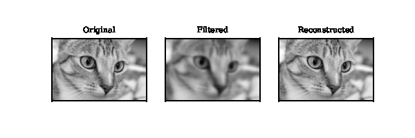
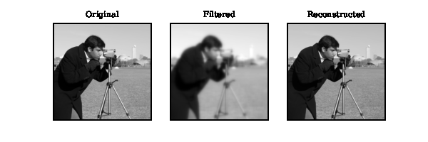
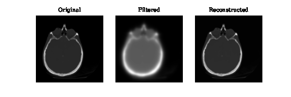
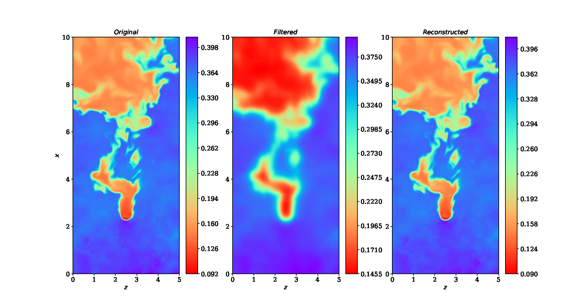

# pyDof

!

 
        
**pyDOF** is a library for designing discrete/digital symmetric filters using 
a multi-objective and constrained optimisation framework [1, 2]. 
This framework allows the user to impose a wide range of constraints to the
discrete filter transfer function such as  monotonicity, positivity, value-fixing, 
gradient smoothing etc. The filter stencil size can be set by the user or computed dynamically
by the solver. **pyDOF** solves the constrained optimisation problem, and outputs automatically 
the discrete filter coefficients in a plain text file which can be readily parsed by an programming language. 
The user can select amongst a wide range of built-in target trasfer functions 
(Gaussian, Helmholtz, 3-point Implicit, Butterworth, sharp cut-off), and may also 
implement their own target transfer function. **pyDOF** can be used to design a wide range
of filters such as low-pass, high-pass, multi band-pass/band-stop etc. For details
on the method we refer the user to [1,2]. 

**Author: Z. Nikolaou (2025).** 

**Contact: ZachariasMNic@gmail.com**

**References:** 

 [1] Z. Nikolaou, L. Vervisch, P. Domingo. Comp. Fluids 255 (2023) 105840. 

 [2] Z. Nikolaou, L. Vervisch, P. Domingo. J. Fluid Mech. 983 (2023) A47. 

Installation: 
-------------

1. Clone the repo to your local machine.  

2. Set environment variables: 
   
   *source setenv.sh*
    
To use:
-------

Have a look at the *./examples/* directory.

Cite:
-----

Z. Nikolaou, P. Domingo, L. Vervisch, D. Drikakis. [arXiv link](https://arxiv.org/abs/2606.26830)

pyDOF: a Python library for the design of discrete forward and inverse filters.
